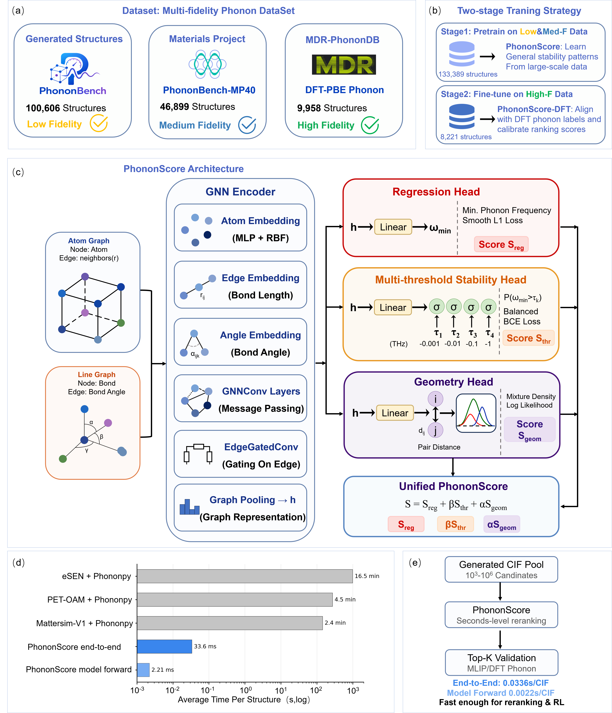

# PhononScore

PhononScore ranks crystalline structures by dynamical stability directly from CIF files.
Two checkpoints are included: **PhononScore**, pretrained on MatterSim phonon labels,
and **PhononScore-DFT**, post-trained on DFT-PBE phonon labels.



This release includes the model and loss functions, both checkpoints, the actual
training loop and LMDB builder, frozen split IDs, CIF inference, and evaluation utilities.

## Installation

```bash
conda env create -f environment.yml
conda activate phononscore
```

The bundled ALIGNN source retains its original license. The exported working
environment is documented in `docs/environment-my_alignn-raw.yml`.

## Score a CIF or a directory

```bash
python -m phononscore.inference.score_cifs \
  --input examples/cifs --out outputs/scores.csv \
  --model phononscore_dft --device cuda --batch-size 32
```

`--input` also accepts a single CIF. If CUDA is unavailable, inference falls back to CPU.
The CSV contains raw outputs, their normalized components, and `standardized_score`;
a companion TXT records timing, the checkpoint hash, and the exact reference moments.
Higher scores prioritize candidates for explicit phonon validation.

The current paper score is

```text
z(prediction) + 0.5 * z(threshold_score) + 0.2 * z(pair_geometry_score)
z(x) = (x - training_mean) / training_std
training_std = sqrt(training_population_variance)
```

Means and population variances are computed once from each checkpoint's actual
gradient-training predictions: 126,719 records for PhononScore and 7,809 for
PhononScore-DFT. The constants in [`configs/fixed_scoring.json`](configs/fixed_scoring.json)
are frozen for all validation, test and query inputs. A single structure therefore
has a defined score, independent of the other structures submitted with it.
The same checkpoint/reference supports comparison across candidate pools; scores
from different checkpoints are not jointly probability-calibrated.
See [Scoring formula](docs/SCORING_FORMULA.md) for the exact constants and custom-model usage.

The defaults exactly reproduce the current paper evaluation: MP20 mean Top100
stable rate 78.75%, DFT-PBE pretrained Top100 85%, and DFT-posttrained Top100 92%.
The selected weights give 81.0% mean Top25/200 stability on the 1,600-record MP20
validation set. The exact evaluation specification and checkpoint hashes are
recorded in [`configs/paper_evaluation.json`](configs/paper_evaluation.json).

## Data and frozen splits

The paper evaluation uses 200 MP20 validation and 800 test candidates per generator:
1,600 structures for fusion-weight selection and 6,400 for testing across eight sources.
A separate balanced DFT-PBE test contains 1,000 structures. No DFT test tuning is performed.

| Cohort | Pool | Actual gradient training | Internal checkpoint validation |
| --- | ---: | ---: | ---: |
| MatterSim pretraining | 133,389 | 126,719 | 6,669 |
| DFT post-training | 8,221 | 7,809 | 411 |

One record per training pool was unused by the original rounded split counts.
Internal checkpoint validation and MP20 score-weight validation have different roles.
The legacy trainer's internal `id_test` mirrors `id_val`; it is not an independent paper test.
Formula separation applies between the complete training pools, score-weight validation,
and external benchmark tests. The internal checkpoint split is structure-based.

[`data/splits`](data/splits) contains frozen internal ID lists, benchmark IDs, counts and
an overlap audit. The portable dataset release is named
`PhononScore_data_splits_20261104.zip`; its accompanying workbook is
`PhononScore_split_ids_20261104.xlsx`. These provide record IDs, CIF IDs, split roles,
labels and relative paths. The [split workbook](data/PhononScore_split_ids_20261104.xlsx) is included here.
The [complete CIF dataset ZIP](https://media.githubusercontent.com/media/xqh19970407/PhononScore/main/data/PhononScore_data_splits_20261104.zip) is hosted with Git LFS (140.9 MiB),
including all 150,610 structures, minimum-frequency labels, manifests, split IDs and the workbook.
The released training pools retain the exact records used for the paper checkpoints.

The earlier source-pool archive remains available at
[Zenodo record 21157982](https://zenodo.org/records/21157982).
That historical archive predates the revised 1,600/6,400 split and should be used
with the new ID assignments, not as an already updated validation/test package.
See [Data splits](docs/DATA_SPLITS.md).

Download the complete dataset directly (no Git LFS client is needed for this link):

```bash
curl -L --fail -o PhononScore_data_splits_20261104.zip \
  https://media.githubusercontent.com/media/xqh19970407/PhononScore/main/data/PhononScore_data_splits_20261104.zip
unzip PhononScore_data_splits_20261104.zip
```

Alternatively, from a Git checkout:

```bash
git lfs install
git lfs pull --include="data/PhononScore_data_splits_20261104.zip"
```

The archive checksum is in
[`data/PhononScore_data_splits_20261104.zip.sha256`](data/PhononScore_data_splits_20261104.zip.sha256).


## Training

After downloading and unpacking the revised portable data:

```bash
bash scripts/train_model.sh pretrain /path/phononscore_data_20261104 outputs/pretrain
PRETRAIN_CKPT=outputs/pretrain/best_model.pt \
  bash scripts/train_model.sh dft_posttrain /path/phononscore_data_20261104 outputs/dft
```

The wrapper builds graph caches using the frozen IDs, then runs the released paper
trainer with the original hyperparameters. See [Training](docs/TRAINING.md) for
commands, objectives, checkpoint selection and training-statistics extraction.

## Verification and throughput

```bash
python -m unittest discover -s tests -v
bash scripts/smoke_test.sh
python scripts/benchmark_1000_cifs.py --input path/to/cifs --gpu 0 --batch-sizes 16,32,64,128
```

The benchmark measures throughput. Scientific Top-K metrics can be computed with
`scripts/evaluate_benchmark.py` using a released test manifest and inference CSV.

## Output columns

`prediction`, `threshold_score`, and `pair_geometry_score` are the three raw heads;
`*_z` columns use the frozen training reference. `standardized_score` is the final
paper ranking score. `final_score` retains the checkpoint's internal training-time
combination (`prediction + 0.6*threshold_score + 0.1*pair_geometry_score`).
Path and formula columns retain CIF traceability.

## License and intended use

The PhononScore code is MIT licensed; bundled ALIGNN retains its own license.
The models provide ranking signals for screening. Explicit phonon calculations
remain the reference for assessing an individual material's dynamical stability.
